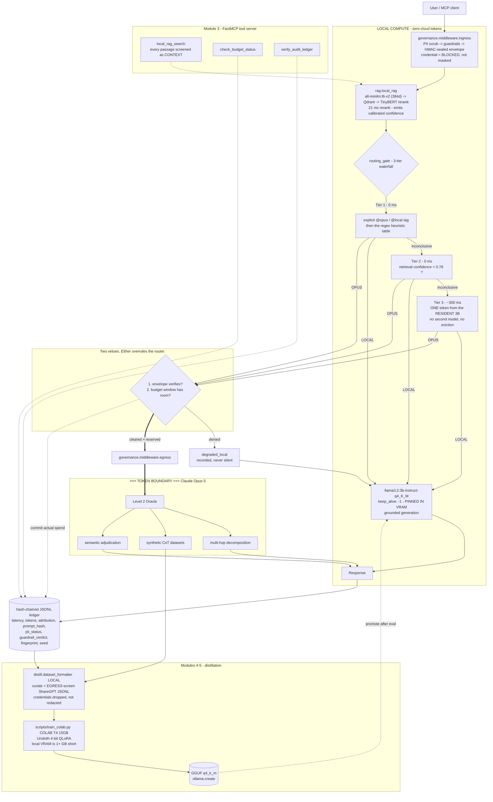

# Architecture

Token boundary legend: everything inside `LOCAL COMPUTE` costs electricity.
Everything crossing `=== TOKEN BOUNDARY ===>` costs Claude Pro quota.

The hardware this is shaped by: 6 GB VRAM (about 5.2 GB usable after the Windows
desktop compositor), 16 GB single-channel host RAM (~22 GB/s, half a dual-channel
rig). Every design choice below traces back to one of those two numbers.

## The waterfall, and why the tiers are in that order

| Tier | Cost | Does what | Escalates when |
|---|---|---|---|
| 1a | 0 ms | `@opus` / `@local` tag | the operator said so; outranks everything below |
| 1b | 0 ms | regex heuristic table | score >= 0.75 |
| 2 | 0 ms | calibrated retrieval confidence | confidence < 0.78 |
| 3 | ~300 ms | one token from the resident 3B | it answers `O` |

Tier 3 was a separate 1.5B model until measurement killed it. Two models do not
co-reside in 5.2 GB, so Ollama evicted one per query - a 2-4 second PCIe reload
that cost more than every other stage combined. See decision 14.

## Tier contract

| Tier | Runs on | Owns | Escalates when |
|---|---|---|---|
| Level 0 | Ollama + Qdrant, local | parsing, chunking, embedding, retrieval, rerank, routing, grounded generation | retrieval confidence below threshold |
| Level 1 | local process | tool orchestration, MCP server, budget accounting | a sub-task is flagged high-reasoning |
| Level 2 | Claude Opus 5, cloud | decomposition, synthesis, adjudication | never; it is the terminal authority |

## Governance invariants

1. No payload crosses the token boundary without a verified `GovernanceEnvelope`.
   Enforced in code by `RoutingGate`, not merely documented.
2. Every routing decision is written to the ledger, including the ones that
   stayed local - absence of a cloud call is itself auditable evidence.
3. Every cloud call carries a determinism seed and a model fingerprint.
4. The budget ledger is authoritative and can veto an escalation the router
   asked for. A veto is logged as `degraded_local`, never silently swallowed.
5. Retrieved corpus text is data, never instructions. It is screened as
   `Direction.CONTEXT` and returned quarantined rather than dropped, so a
   poisoned corpus surfaces instead of hiding.
